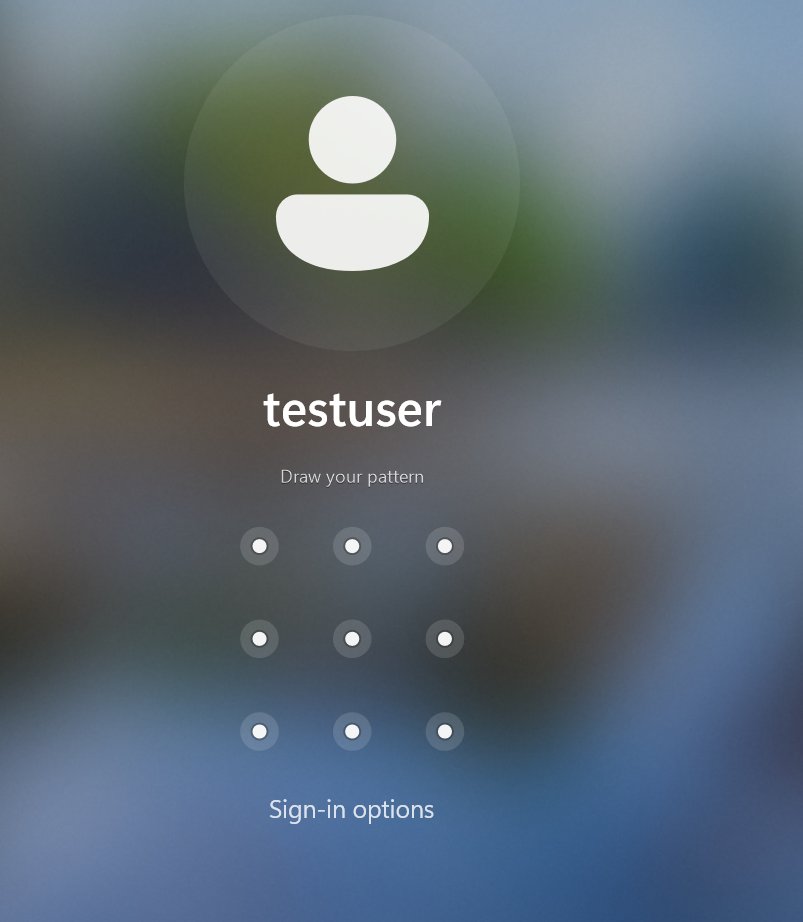
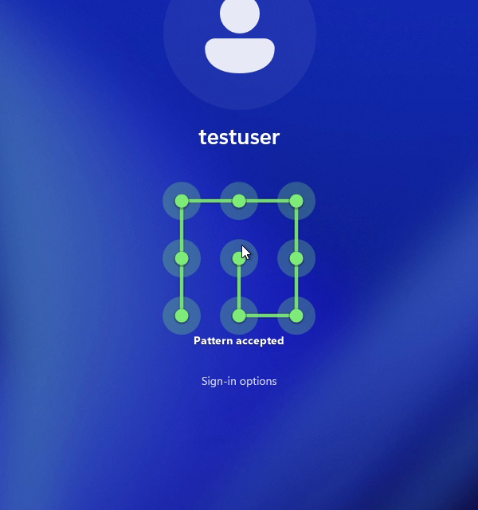

# Patlock: pattern sign-in for Windows

Draw an Android-style 3x3 pattern with your trackpad or mouse to unlock Windows,
instead of typing a password or PIN.

<p align="center">
  
</p>

> [!WARNING]
> **Experimental.** Patlock has been built and tested only inside a Windows 11 virtual
> machine. It has **not** been tested on real hardware, the binaries are **not code-signed**,
> and there has been **no independent security review**. Do not install it on a PC you
> depend on. It is a convenience sign-in, not stronger than your Windows password.

## What it does
- Adds a **Pattern** option to the Windows lock and sign-in screens, next to Password and
  PIN. It never removes or changes the built-in options.
- Draw by click-and-drag, or without clicking: rest on a dot, glide through the dots and
  pause. **Esc** restarts a stroke without using an attempt.
- After a correct pattern, Windows itself performs the real sign-in with the stored
  password. Patlock is a Windows **Credential Provider** (a 64-bit C++ DLL loaded by
  `LogonUI.exe`) and hands Windows a standard `KERB_INTERACTIVE_UNLOCK_LOGON` credential.

| Lock screen | Correct pattern |
|---|---|
|  |  |

## How it protects the stored password
- The Windows password is encrypted with AES-256-GCM. The key is wrapped by the **TPM**,
  and only a pattern-derived authorisation unlocks it. Software-only storage is refused
  unless an administrator explicitly allows it on a test machine.
- 5 wrong patterns -> 30 s delay, rising to 1, 5 and 15 minutes; after 10 the pattern is
  disabled until a full password sign-in. The counter survives reboots.
- Secrets are wiped from memory after use, compared in constant time, and never logged.
- Recovery: Safe Mode, a backup admin account, or a one-line **kill switch** that hides the
  Pattern tile. See [RECOVERY.md](docs/RECOVERY.md).

Details and honest limits: [SECURITY.md](docs/SECURITY.md),
[current storage format](docs/CURRENT_STORAGE.md).

## Status
| Area | State |
|---|---|
| Build (VS 2022, CMake) and unit tests | ✅ no warnings, 6/6 tests pass |
| Enrollment, unlock, lockout in a Windows 11 VM | ✅ tested by the maintainer |
| 175% scaling, high contrast, installer/uninstaller, Safe Mode recovery | ✅ tested in the VM |
| Real hardware, Microsoft/domain accounts, Windows 10 | ❌ not tested / not supported |
| Code signing, independent security review | ❌ not done |

Only **local** Windows accounts are supported.

## Try it (in a VM only)
Inside a Windows 11 VMware VM with Visual Studio 2022 (Desktop development with C++):
1. Take a VM snapshot and make sure a second admin account works.
2. Clone this repo (e.g. to `C:\patlock`) and run `update.cmd`. It builds, runs the tests,
   and installs only if every test passes.
3. Run `build\Release\patlock_enroll.exe`, enter a local account and its password, and
   draw your pattern twice.
4. Press Win+L and draw the pattern.

Full guides: [VM acceptance](docs/VM_ACCEPTANCE.md), [production notes](docs/PRODUCTION.md),
[progress log](docs/PROGRESS.md).

---

## Architecture

Patlock comprises four core components:

1. **Credential Provider DLL (`PatlockProvider.dll`)**:
   - Implements `ICredentialProvider` and `ICredentialProviderCredential2`.
   - Adds a distinct "Pattern" tile to LogonUI beside the built-in Password and PIN tiles.
   - Opens a modeless pattern-drawing surface while LogonUI continues to process
     Password, PIN, user-switching and Sign-in-options interactions.
   - Verifies pattern hashes, manages attempt counters, checks lockout delays, and packages serialized credentials.
   - Never filters, replaces, or alters built-in Windows credential providers.

2. **Pattern Window (`src/common/pattern_window.cpp`)**:
   - Modeless, per-pixel-alpha 3x3 grid anchored under the native username; the
     status line sits above the grid.
   - Draw by press-drag-release, or without holding a button: rest briefly on a dot,
     move through the dots, and pause (0.65 s) to submit. Using all nine dots submits
     at once. Leaving the grid, lifting a finger or a dropped drag does not cancel.
   - **Esc** restarts the current stroke; an unsubmitted stroke never uses an attempt.
   - Implements the prototype's skipped-dot rule (e.g. crossing between unvisited opposite corner dots automatically captures the center dot).
   - Enforces a minimum length of 5 dots.
   - Includes optional "Hide trail" mode to resist shoulder surfing.

3. **Enrollment & Password Refresh Tool (`patlock_enroll.exe`)**:
   - Elevated desktop application run by the administrator.
   - Validates the local account password with `LogonUserW` and extracts the account SID.
   - Records and confirms the 3x3 pattern twice.
   - Supports `--refresh` to reset lockout after full-password verification, and
     `--remove` to remove enrollment and the active TPM key.

4. **Standalone Tuning Demo (`pattern_window_demo.exe`)**:
   - Portable desktop application that runs with zero provider installation or registry changes.
   - Used in Phase 7 to tune trackpad feel, gesture sensitivity, and hit targets on real laptop hardware.

---

## Security Model and Honest Boundaries

> [!IMPORTANT]
> Patlock is a **convenience sign-in mechanism**, similar to an Android lock pattern or Windows PIN. It is **not stronger than a complex Windows password**. BitLocker or Device Encryption is a mandatory prerequisite for offline disk security.

### Threat Model & Protections:
- **Keyspace Limitation**: the 3x3 pattern space is small. Online guessing is limited by:
  - Minimum 5 dots required.
  - Escalating lockout delays: 5 wrong attempts -> 30s; 6 -> 1 min; 7 -> 5 min; 8-9 -> 15 min; 10 wrong attempts permanently disables Pattern sign-in until full password re-verification.
  - Attempt reservations are committed in registry transactions before verification (a crash can consume an attempt).
- **TPM-backed storage by default**:
  - **TPM Mode**: the Platform Crypto Provider wraps the AES key using RSA-OAEP
    SHA-256 and receives a separate pattern-derived authorization through its
    UTF-16 PIN property. See [TPM validation](docs/TPM_VALIDATION.md): wrong-auth
    rejection and hardware anti-hammering still require VM/hardware evidence.
  - A software-key record is refused by default because an administrator able to
    read the registry can recover its key. It is available only when an
    administrator explicitly sets `AllowSoftwareKey=1` on a throwaway test VM.
- **Boot Availability and Escalating Lockout (Option A)**:
  - Pattern unlock remains available across reboots, matching Windows Hello PIN convenience.
  - Brute-force attacks are constrained by durable escalating lockout (30s at 5 attempts, escalating to 1m, 5m, 15m; disabled after 10 attempts).
  - Password expiration age is configurable via `kMaxPasswordAge` (default disabled; configurable to 30 days). Password changes are handled by one-shot failure detection and fallback to the built-in Password tile.
- **Fail-Closed Execution**:
  - Any error, corrupt record, clock rollback, or TPM fault immediately declines the tile.
  - Patlock never filters or alters the built-in Password tile. Verify its
    continued operation in every failure/recovery acceptance case.
- **No secrets in logs**:
  - Application Event Log entries record only SIDs, counters and HRESULTs for
    enrollment, accepted/incorrect patterns, lockouts, disablement and TPM-key
    retirement. They never record patterns, passwords, keys or hashes.
- **Memory Hygiene**:
  - Sensitive buffers are wrapped in `patlock::Secret` RAII containers and wiped with `SecureZeroMemory` immediately after use.
  - Hash and MAC comparisons are performed in constant time (`patlock::Equal`).

---

## Building

### Prerequisites
- Windows 11 (or Windows 10 x64)
- Visual Studio 2022 with **Desktop development with C++** workload
- CMake 3.24 or newer

### One-step update (VM)
Inside the VM, run `update.cmd`: it elevates, pulls, finds Visual Studio/CMake, builds,
runs CTest and deploys only if every test passes.

### Build with CMake
Inside the **Windows 11 VM**, open Developer PowerShell for VS 2022:
```powershell
cd patlock
cmake -B build -S . -A x64
cmake --build build --config Release
```

### Run Automated Unit Tests
```powershell
ctest --test-dir build -C Release --output-on-failure
```
Verifies:
- `pattern_rules`: 3x3 skipped-dot calculations, bounds, duplicates, and minimum length rules.
- `crypto_policy`: PBKDF2 hashing, constant-time equality, escalating lockout intervals, memory wiping, and TPM detection.
- `arming_gate`: retained input-gate regression checks.
- `registry_transactions`: commit, rollback and removal in a temporary HKCU key.
- `provider_contract`: optional outputs, invalid bounds and no-credential defaults.

These are test targets, not recorded passes. The guarded combined VM command is
`install\build-and-test.ps1 -AcknowledgeVm`.

---

## Release, Installation & Testing in a Windows 11 VM

All lock-screen testing should be performed inside a Windows 11 VMware Workstation Pro virtual machine.

1. **Take a VM Snapshot** before installing anything.
2. Ensure a second administrator account exists with a known password.
3. Build, test and package in elevated Developer PowerShell inside the VM:
   ```powershell
   .\install\Build-Release.ps1 -CertThumbprint <certificate-SHA1>
   Expand-Archive .\dist\Patlock-Release.zip .\dist\Patlock-Release
   .\dist\Patlock-Release\Install.cmd
   ```
4. **Enroll your local account**:
   ```powershell
   & "$env:ProgramFiles\Patlock\patlock_enroll.exe"
   ```
   Enter your local account credentials and draw your 5+ dot pattern twice.
5. **Lock the workstation**:
   Press `Win+L`. Select Pattern, then press-drag-release the enrolled pattern.
   Or hover briefly on a dot, draw without holding a button, and pause for half a
   second after at least five dots to submit. Windows performs actual authentication.
6. **Uninstall cleanly**:
   ```powershell
   .\dist\Patlock-Release\Uninstall.cmd
   ```

---

See [production deployment](docs/PRODUCTION.md) for upgrade, signature,
uninstall, Safe Mode recovery and release-gate requirements. Never distribute
an unsigned or VM-unverified build.

---

## Recovery

If sign-in is ever interrupted:
1. Revert your VM snapshot.
2. Or boot into Windows Safe Mode (hold Shift while clicking Restart -> Troubleshoot -> Advanced options -> Startup Settings -> Restart -> 4) and run `install\unregister.reg`.
3. Or sign in with the backup administrator account using the standard Password tile.
4. Or hide the Pattern tile without uninstalling (kill switch, also settable offline from WinRE):
   `reg add HKLM\SOFTWARE\Policies\Patlock /v DisableProvider /t REG_DWORD /d 1 /f`
See `docs/RECOVERY.md` for complete recovery procedures.

---

## License
MIT. See [LICENSE](LICENSE). Parts of `src/provider` come from Microsoft's SampleCredentialProvider (MIT, [src/provider/LICENSE.microsoft](src/provider/LICENSE.microsoft)). Provided "as is", without warranty.
